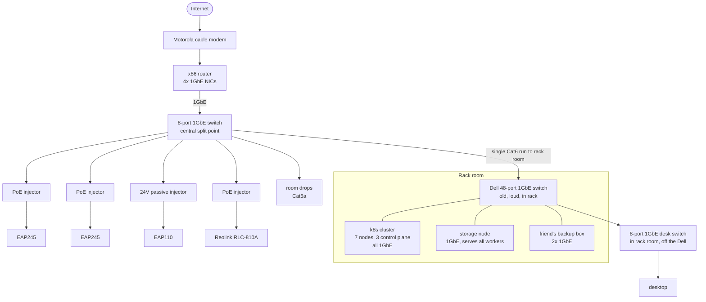
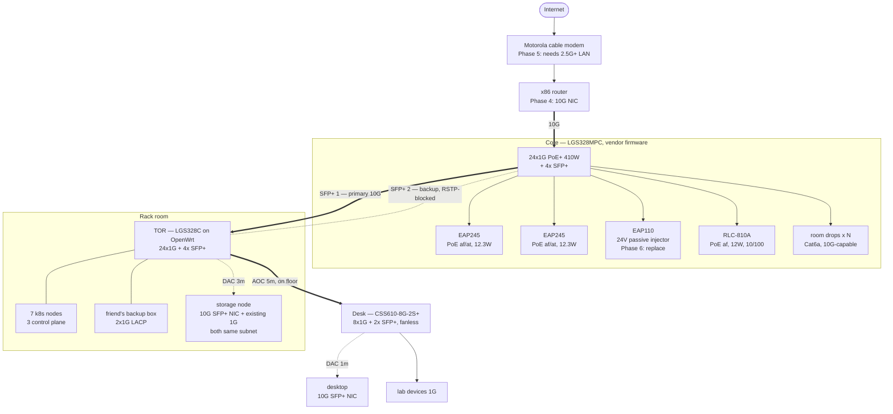
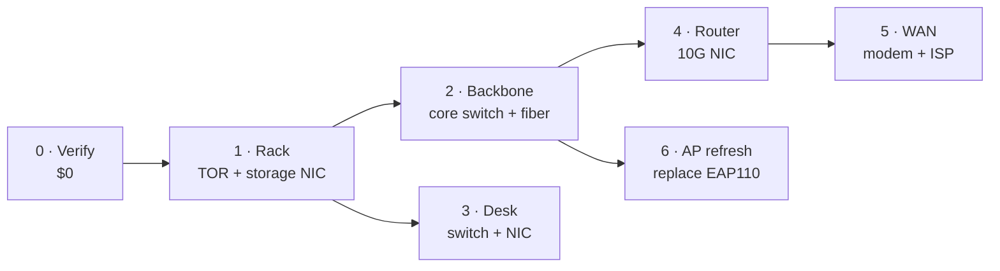

# 10G Backbone Upgrade Plan

**Prepared:** 2 November 2026
**Scope:** Home network — 1 GbE flat L2 → 10G backbone with PoE consolidation
**Approach:** Used gear where possible, no rush on purchasing, Ansible-managed

---

## 1. Current Layout

Everything is one flat L2 segment at 1 GbE. Four PoE injectors hang off the core switch. The rack is isolated from the rest of the house by a single 1 GbE uplink.

### Known bottlenecks

| # | Bottleneck | Impact |
|---|---|---|
| 1 | Storage node has a single 1 GbE port, 3 workers pull from it | 3:1 contention on the one link that matters most |
| 2 | All rack traffic crosses one 1 GbE uplink | House↔rack flows share 1 GbE |
| 3 | 4 PoE injectors | Wall warts, single points of failure, no remote power cycling |
| 4 | Dell 48-port switch | Noise, heat, idle draw — in a room with a desk in it |
| 5 | EAP110 is 24 V passive PoE, 802.11n, 10/100 wired | Cannot be powered by a standard PoE switch; caps at ~100 Mbps |

---

## 2. Future Layout

### Key design decisions

| Decision | Choice | Rationale |
|---|---|---|
| Addressing | **Single flat subnet** — storage and control plane on the same L2, addressed by IP | Simpler; no policy routing. See caveats below |
| Storage addressing | NVMe-oF portal / NFS target addressed by explicit IP, not a DNS name with both IPs | A name resolving to two addresses eventually hands a client the wrong one |
| Storage NICs on | Same switch (TOR) | User preference; foregoes cross-switch break-glass |
| Uplink redundancy | 2x 10G, RSTP hot standby, **no LACP** | Automatic failover, no bond-member-down edge cases, no frame duplication |
| Jumbo frames | **Not viable on a flat subnet** — would have to be end-to-end on every device including all house traffic | See Open Risks. Drops NVMe-oF throughput somewhat |

### Consequences of a single flat subnet

Both NICs on a node share one subnet, so nodes hold **two IPs on the same L2**. This works, but three things need attention:

1. **Same-subnet multi-homing causes asymmetric traffic.** Inbound and outbound can leave by different interfaces. With TCP NVMe-oF and NFS this is survivable — established flows stay pinned — but the occasional 1 GbE-speed transfer to the storage node should be expected, not diagnosed as a fault.
2. **Same-subnet multi-homing has no reverse-path ordering.** For load sharing you'd normally want `arp_ignore`/`arp_announce` tuning; without it, the storage node will happily reply out the "wrong" interface. That's *why* you get the occasional slow transfer.
3. **Addressing is by IP, so no DNS indirection.** Do not create a record that resolves both addresses — it will round-robin and break flows. Address targets explicitly.

**Recommended mitigation (still single subnet, no policy routing):** put both storage-node NICs on the TOR as planned, but set `--node-ip` to the 1 GbE address, bind the NVMe-oF portal to the 10G address explicitly, and set `arp_ignore=1` / `arp_announce=2` on the storage node. That keeps control-plane traffic on 1G and makes the storage NIC the preferred reply path without touching routing tables.

**Jumbo frames trade-off:** MTU is per-L2-segment, so a flat subnet means 9000 either everywhere or nowhere. 1500 it is. NVMe-oF over TCP at 1500 costs CPU per byte and a modest amount of throughput — real, but at a 3 Gbps ceiling it's unlikely to be what limits you.

---

## 3. Phases

Phases 1 and 3 are independent of Phase 2. Phase 4 depends on Phase 2. Phase 2 contains the only irreversible physical work.

---

### Phase 0 — Verify (no spend)

One evening. Any of these can invalidate a purchase.

- [ ] **Storage node PCIe slot** — confirm x4-electrical or better, not an x16-length slot wired at x1 (~8 Gbps ceiling)
- [ ] **Desktop PCIe slot** — same check
- [ ] **Core→rack run** — measure the real path with a string, add ~2 m service loop each end. Confirm conduit route and accessibility
- [ ] **LGS328C fan count** — confirm before buying two of them
- [ ] **Router CPU** — identify chip; determines whether Phase 4 is a $30 NIC or a new box
- [ ] **Modem LAN port** — 1G or 2.5G? Input to Phase 5
- [ ] **Cable jacket print** — already confirmed Cat6a throughout

**Cost: $0**

---

### Phase 1 — Rack: TOR + storage NIC

**Why first:** the only phase that pays off with zero dependency on anything else. Removes the 3:1 storage contention immediately. Also retires the Dell (noise, heat, idle draw).

| Item | Spec | Est. |
|---|---|---|
| TOR switch | **Linksys LGS328C** — 24x1G + 4x SFP+, OpenWrt support merged Oct 2025, images in 25.12 | **$150** used |
| Storage NIC | ConnectX-3 single-port SFP+ (MCX311A) — PCIe 3.0 x4 | **$20–45** |
| DAC | 3 m passive SFP+ | **$15–20** |
| | **Phase total** | **$185–215** |

**Tasks:**
- Install NIC, confirm link at 10G (or 25G if using CX-4 LX)
- Rack TOR, move 7 nodes + friend's box + storage 1G NIC + desk run
- Retire Dell 48-port
- Pin `--node-ip` on the storage node to the **1 GbE** address
- Bind the NVMe-oF portal to the **10G** address; address it by IP, never by a DNS name
- Set `arp_ignore=1` / `arp_announce=2` on the storage node (same-subnet multi-homing)
- **Leave MTU at 1500** — a flat subnet means jumbo would have to be everywhere
- TOR uplink to old core stays 1G — **nothing regresses**, nothing improves until Phase 2

**SFP+ budget after this phase:** storage (1), desk (2), core uplink (3), spare (4)

**No longer need to change TOR model:** since jumbo frames are off the table on a flat subnet, the realtek MTU limitation no longer argues for MikroTik. LGS328C stands.

---

### Phase 2 — Backbone: core switch + fiber pull

**Why here:** the only irreversible physical work. Deliberate weekend, not a rush. Delivers the two visible wins — injectors gone, 10G house↔rack.

| Item | Spec | Est. |
|---|---|---|
| Core switch | **Linksys LGS328MPC** — 24x1G PoE+ (410 W) + 4x SFP+, vendor firmware only | **$170** used |
| Fiber | 2x LC duplex OM4, measured length (30 m ≈ $26.31 each) | **$53** |
| Conduit | 1" flexible conduit + fittings (1-1/4" if the path is easy) | **$50–80** |
| Fireblock | Approved sealant at every ceiling/wall penetration | **$12** |
| Faceplates | 2x fiber faceplate / surface box + LC feedthrough couplers | **$30–50** |
| Patch cords | 4x short LC-LC duplex (faceplate → switch) | **$25** |
| Pulling | Pull string, pull eye/grip, cable lube | **$20** |
| Optics | 4x 10GBASE-SR SFP+ (FS #11552) @ $20 | **$80** |
| Testing | VFL tester | **$20** |
| | **Phase total** | **$460–510** |

**Optional:** second LGS328MPC as cold spare (+$170) — the core switch is a single point of failure for the entire house, and you can't get why-cheap insurance like that often.

**Tasks:**
- Pull both LC cables through flexible conduit (one at a time, lubricated, ends protected)
- Fireblock all penetrations; support conduit ~every 3 ft
- Pull a fresh pull string through *after* the cables are in; verify it slides
- Terminate at faceplates, patch cords to switches
- Inspect and clean LC endfaces; verify with VFL before energising
- Swap core switch; move APs + camera to PoE ports; **discard 3 of 4 injectors**
- Bring TOR uplink up at 10G (primary), second link up but RSTP-blocked

**Core port map:**

| Port | Device |
|---|---|
| 1 | EAP245 (PoE) — 12.3 W |
| 2 | EAP245 (PoE) — 12.3 W |
| 3 | EAP110 via **24 V passive injector** (not a standard PoE port) |
| 4 | RLC-810A (PoE) — 12 W, negotiates 100M |
| 5+ | room drops |
| SFP+ 1 | TOR primary |
| SFP+ 2 | TOR backup (RSTP alternate) |
| SFP+ 3 | router (Phase 4) |
| SFP+ 4 | spare |

**PoE budget:** ~37 W of 410 W (9%). Per-port all within 802.3at.

---

### Phase 3 — Desk

| Item | Spec | Est. |
|---|---|---|
| Desk switch | **MikroTik CSS610-8G-2S+IN** — 8x1G + 2x SFP+, fanless, 5 W typical | **$119** new |
| Desktop NIC | ConnectX-3 single-port SFP+ | **$20–45** |
| AOC | 5 m SFP+ AOC (TOR → desk switch), order 5 m not 3 m | **$27–45** |
| DAC | 1 m passive SFP+ (desk switch → desktop) | **$12–15** |
| Floor cord cover | Against baseboard | **$15** |
| | **Phase total** | **$193–239** |

**Alt:** CRS310-8G+2S+IN ($219) for 8x 2.5G ports — but it has a fan, and the desk switch sits ~18 inches from the user.

**Note:** this supersedes the earlier "fiber straight to the desktop" plan. The desktop now sits one hop behind the desk switch.

---

### Phase 4 — Router (optional until WAN is real)

With a flat L2, the router only ever sees internet traffic — it is **not** in the path of storage or cluster traffic. This phase buys WAN headroom and nothing else.

| Item | Spec | Est. |
|---|---|---|
| Router NIC | ConnectX-3 or Intel X520-DA1 single-port SFP+ | **$20–45** |
| *(contingency)* | Replacement router box if Phase 0 says the CPU can't route 10G | $0–400 |
| | **Phase total** | **$20–105** (typical) |

**Skip this entirely if the WAN stays at 1 GbE.** A Celeron-class box flattens at 2–4 Gbps regardless of NIC.

---

### Phase 5 — WAN (market watch, not a purchase)

Nothing to buy until the upstream exists. Cable's binding constraint is upstream (typically 35–50 Mbps), which no router fixes. DOCSIS 4.0 coverage remains patchy.

- Modem with 2.5G+ LAN port
- ISP tier to match

**Cost: TBD**

---

### Phase 6 — AP refresh

Replace the EAP110 with an AP that is all three of: **802.3af/at PoE-in**, **gigabit wired**, and **OpenWrt-capable** (mt76/Atheros-class, not vendor-locked Broadcom).

| Item | Est. |
|---|---|
| OpenWrt-capable PoE AP | **$70–120** |
| | **Phase total $70–120** |

**Sequenced after Phase 2** — there is no standard PoE port to plug it into until the core switch is in.

**Side effect:** this is when the injector count actually reaches zero. Three go in Phase 2; the fourth survives until here.

---

## 4. Cost Summary

| Phase | Low | High |
|---|---|---|
| 0 — Verify | $0 | $0 |
| 1 — Rack | $185 | $215 |
| 2 — Backbone | $460 | $510 |
| 3 — Desk | $193 | $239 |
| 4 — Router | $20 | $105 |
| 5 — WAN | — | — |
| 6 — AP refresh | $70 | $120 |
| **Total (1–4)** | **$858** | **$1,069** |
| **Total (1–4, 6)** | **$928** | **$1,189** |
| + optional core switch spare | +$170 | +$170 |

Low end assumes: used gear at target prices, ConnectX-3s, budget conduit, no router box replacement.
High end assumes: top of each range and the VFL tester.

---

## 5. Verified vs Estimated Prices

Prices checked November 2026. Treat as a snapshot, not a quote.

| Item | Verified price | Source |
|---|---|---|
| Linksys LGS328C | **$150** used ("Used–Very Good") / $259.99 open box | Amazon |
| Linksys LGS328MPC | **$170** used | (user-observed) |
| MikroTik CRS328-24P-4S+RM | **$395** used | reseller |
| MikroTik CSS610-8G-2S+IN | **$119** MSRP | MikroTik |
| MikroTik CRS310-8G+2S+IN | **$219** MSRP | MikroTik |
| ConnectX-3 MCX311A | **$20–45** used | eBay/resellers |
| ConnectX-4 LX (MCX4121A) | **~$62–67** used | idealo |
| 10GBASE-SR SFP+ | **$20.00** | FS #11552 |
| LC duplex OM4, 30 m | **$26.31** | SFPcables |
| MPO-12 OM4 trunk 30 m | $114.50 | CablesForLess *(not used)* |
| Cisco C1200-24T-4X | $389.99 | *(reference only)* |

Everything else — conduit, faceplates, patch cords, fireblock, DACs, AOCs, VFL — is estimated from typical retail.

**Note:** SFP+ AOC 5 m is estimated $27–45. The FS page showed a Brazil-localised price only (R$150).

---

## 6. Purchasing Guidance

Buying order, roughly by value-per-dollar:

1. **ConnectX-3 + DAC (~$40)** — the whole Phase 1 win, no switching decision required, fully reversible. Do this first.
2. **LGS328MPC at $170** — buy before the fiber. It's a same-day win you can bench-test and burn in; fiber is a weekend project.
3. **LGS328C** — set a price alert, target under $150. It's an obscure enough model that listings sit.
4. **Fiber + pathway** — the only irreversible spend. Buy once.
5. **Optics and DACs last** — after switches are in hand, so you match vendor coding to what you own.
6. **Desk switch** — buy new; used saves nothing at $119.

### Price targets to watch for

| Item | Target | Note |
|---|---|---|
| LGS328C | **< $150** | Listings sit; will drop to $100–120 |
| LGS328MPC | **< $250** | At $170 it's already good — buy |
| ConnectX-3 MCX311A | **< $30** | These flood the market in lots; don't pay $45 |
| ConnectX-4 LX dual SFP28 | **< $65** | Only if you want the 25G door |
| 10GBASE-SR + | **$20** | FS sets the floor; avoid no-name $8 modules (coding issues) |

### Avoid

- **Brocade ICX6450 / Aruba S2500** — the classic budget 10G picks ($60–120) are rack-fan screamers. Bad trade with the rack in your room.
- **10GBASE-T SFP+ modules** — run hot (~2.5 W), often 30 m limited, some switches refuse them. Use an SFP+ NIC instead.

### On arrival: bench-test the LGS328MPC

Amazon's 30-day return window is what de-risks this purchase.

- [ ] Test **all 24 ports**, not a sample
- [ ] Test every PoE port against a real load (an AP pulling actual watts), not a PoE tester
- [ ] **Confirm the PSE chipset** — Realtek = v2 (only variant with any future OpenWrt PoE path); Broadcom = v1 (vendor firmware forever). May be no external marking
- [ ] Check fans **under load**, not at idle
- [ ] If it's a bad unit, return it inside 30 days

---

## 7. Open Risks & Open Questions

| Risk | Detail | Mitigation |
|---|---|---|
| **Jumbo frames** | Not available on a flat subnet without 9000 end-to-end on every device, including all house traffic. Separately, the OpenWrt realtek driver's jumbo support is mid-rework (PR #24245 lowered advertised max MTU from 9000 to 1600) | **Accepted trade** — MTU 1500 everywhere. Costs some NVMe-oF throughput and CPU per byte. Also removes the last reason to pick MikroTik over LGS328C |
| **Same-subnet multi-homing** | Two NICs on one L2 for the storage node. Asymmetric paths, and without `arp_ignore`/`arp_announce` tuning some flows will leave the 1G interface | Pin `--node-ip` to 1G, bind the NVMe-oF portal to the 10G IP, address targets by IP, set `arp_ignore=1` / `arp_announce=2` |
| **LGS328MPC v1/v2 lottery** | Externally indistinguishable; v1 (Broadcom PSE) has no OpenWrt path at all. Only the boot/upgrade header differs | Buy from a 30-day-return source. Confirm chipset on arrival |
| **No OpenWrt PoE** | LGS328MPC's OpenWrt support is an open PR (#23466); PoE PSE driver is a separate unlanded PR | Accept vendor firmware on the core. "OpenWrt everywhere" is not reachable for PoE + 4x10G today |
| **Core switch is a SPOF** | Every room drop, AP, camera and rack path dies with it | Keep a cold spare ($170). Acceptable at this price |
| **Fan noise** | Both Linksys PoE models carry 2–3x 40 mm fans at 8200 rpm. Rack is 10 ft from the desk | LGS328C at TOR is non-PoE (verify fan count). Core switch is expected to be the loud one |
| **EAP110 can't use PoE** | 24 V passive PoE only. Standard PoE PSE never negotiates with it | Keep one passive injector until Phase 6 |
| **Single-flow cap on 2 links** | 2x10G = 20G aggregate but one flow caps at 10G. And without LACP there's no aggregate at all — second link is standby only | Fine at 3:1. Revisit only if house↔rack flows grow |
| **TOR SFP+ fully committed** | storage, desk, uplink x2 = 4 of 4. Zero spare | Growth goes to the 24x1G ports, or a second fiber pull. Pull string is in the conduit |

### Still to research

- Which AP platform (the two EAP245s are the next thing to age out, and the platform choice probably decides their fate — do it as one pass, not per-AP)
- Router CPU capability at 10G
- Whether the current modem has a 2.5G port

---

## 8. Ansible Notes

- OpenWrt is **per-device firmware, not a fleet controller**. No push-config-to-fleet; you drive UCI over SSH — which is exactly what Ansible is good at
- Two firmware families means two role structures: `openwrt_switch` (TOR) and `vendor_switch` (core — web UI/SSH/SNMP, not UCI)
- Flash the LGS328C via **serial console** (UART 115200 8N1 over RJ45). No web-UI install path — the OpenWrt NAND layout differs from vendor
- Dual-boot is preserved: `fw_setsys bootpartition 1` returns to stock, and the vendor image can be reflashed over serial. **Keep the USB-serial adapter** — you'll want it the first time a config push locks you out
- Stage the TOR switch as a **bench build before the cutover** — flash and configure it fully before it touches the rack, so the swap is a cable move rather than an install-and-configure-under-pressure

---

## PoE Compatibility Notes (checked against device datasheets)

| Device | PoE standard | Max draw | Works on LGS328MPC? |
|---|---|---|---|
| EAP245 (x2) | 802.3af (datasheet) — TP-Link PoE guide lists 802.3at | 12.3 W each | Yes |
| **EAP110** | **24 V passive PoE only** | 2.8 W | **No** |
| RLC-810A | 802.3af, 48 V active | <12 W | Yes |

The EAP110 keeps its 24 V passive injector (or a DC adapter) on a normal port. Passive PoE injectors do not negotiate; an 802.3af/at PSE never applies voltage to a device that does not handshake.

The RLC-810A's Ethernet port is 10/100, not gigabit. It will negotiate 100M; this is expected, not a fault.

Total on-switch PoE draw is roughly 37 W of the 410 W budget.
